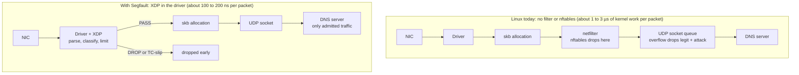
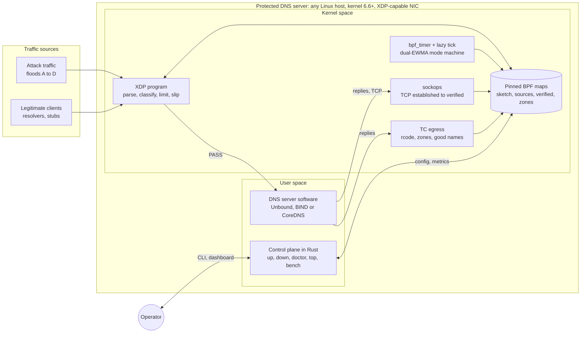
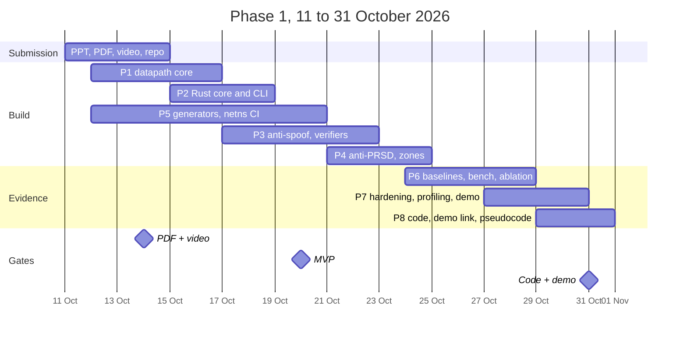

# A3-PS022-TC005 · Segfault

### Segfault: Drop the Flood, Keep the Queries

**AIORI Hackathon 3 · Cybersecurity · PS-022: eBPF/XDP Rate Limiting for DNS Query Floods in a Lab**

| | |
|---|---|
| **Team** | Segfault |
| **Team code** | A3-PS022-TC005 |
| **Institute** | Institute of Engineering and Management (IEM), Kolkata |
| **Members** | Debangan Mali (lead) · Saraswata Chatterjee · Partha Chakraborty (Faculty) |

---

## 📄 Submission

| Deliverable | Link |
|---|---|
| Presentation (PDF) | [A3-PS022-TC005_Segfault.pdf](A3-PS022-TC005_Segfault.pdf) |
| Team introduction video | [Watch on YouTube](https://youtu.be/OXa8lPYKOgs) |
| Source code and working demo | Due 31 Oct 2026 (Level 2) |

> All performance figures in the presentation are **targets, to be validated**, unless marked as measured.

---

## The problem

Under a DNS query flood, a Linux server fails twice: it **burns CPU on every packet**, and then it **drops packets blindly**.

- **Cost:** each packet pays about 1 to 3 µs of kernel work (skb allocation, netfilter, socket) before any drop happens.
- **Blind drops:** a full socket queue drops legitimate and attack queries alike.
- **Spoofing:** forged source addresses defeat simple per-source limits.
- **Pulses and random subdomains:** bursts beat slow averages, and unique names bypass the resolver cache.

---

## Our solution

One **XDP program** decides in the NIC driver, before the kernel allocates a socket buffer. It runs three cheap layers, cheapest first:

1. **Bounded parse and sanity check:** up to 2 VLANs, IPv4/IPv6 (up to 4 extension headers), QNAME up to 255 bytes; malformed packets and fragments are dropped.
2. **Spoof-resistant state:** a Count-Min Sketch sees every source first; only heavy hitters get an exact, lockless GCRA limiter, so spoofed floods cannot churn the state table.
3. **Verified priority:** clients proven real by a **DNS cookie** or a **TCP handshake** keep their share of capacity during an attack.

Over budget, traffic gets a rate-limited **truncated reply (TC-slip)**, so real resolvers retry over TCP. Everything else is dropped.

| Scenario | How Segfault handles it |
|---|---|
| **A** Single-source flood | The sketch flags the source within a few packets; an exact GCRA entry drops the excess |
| **B** Distributed spoofed flood | Random sources are never promoted; prefix keys catch clusters; a leased global pool caps unknown traffic |
| **C** Pulsed random-subdomain flood | Per-packet GCRA leaves pulses no free window; a zone sketch plus NXDOMAIN ratio flags the hammered zone |
| **D** Flash crowd (extra test) | Familiar clients and low NXDOMAIN keep the system out of attack mode, which tests for false positives |

---

## Architecture

Only the XDP program touches every packet. The other components run off the hot path.

**Stack:** XDP datapath in C (libbpf) · control plane and CLI in Rust · Unbound, BIND or CoreDNS as the protected DNS server.

---

## Evaluation plan (PS-022 compliance)

| PS-022 requirement | How it is met |
|---|---|
| One Linux host pair, controlled lab | Hyper-V target + traffic generator on a private switch |
| Bounded UDP/DNS parsing | Fixed loop limits, checked by the eBPF verifier |
| Per-source and global rate limits | GCRA source table + leased global pool |
| 3 synthetic flood patterns | Scenarios A, B, C (+ D) |
| No-filter and nftables baselines | Same runs, identical conditions |
| XDP-capable NIC or generic mode | `hv_netvsc` native mode and generic mode, both measured |
| Throughput, CPU, legit success, drops | Collected by one command: `segfault bench run` |
| No public flood testing | Generator locked to lab address ranges |

**Out of scope, as PS-022 states:** public flood testing, full DNS semantic parsing, universal PRSD detection, and any claim of eliminating reflection attacks.

---

## Timeline

**Later phases:** Phase 2 Harden (1 to 23 Nov) → Phase 3 Scale (1 to 16 Dec) → Phase 4 v1.0 (Jan to Mar 2027)

| Date | Milestone |
|---|---|
| 14 Oct 2026 | Presentation and team introduction video |
| 20 Oct 2026 | MVP meeting every PS-022 requirement |
| 31 Oct 2026 | Source code, benchmark results and working demo |

---

## References

The full list of 17 references (papers, RFCs and kernel documentation) is on the last slides of the [presentation](A3-PS022-TC005_Segfault.pdf). Key sources:

- T. Høiland-Jørgensen et al., "The eXpress Data Path," ACM CoNEXT 2018
- NLnet Labs, XDP DNS work (XDPeriments, XDP RRL, XDP Cookies)
- RFC 1035, RFC 7766, RFC 7873, RFC 9018
- Linux kernel BPF documentation: https://docs.kernel.org/bpf/
