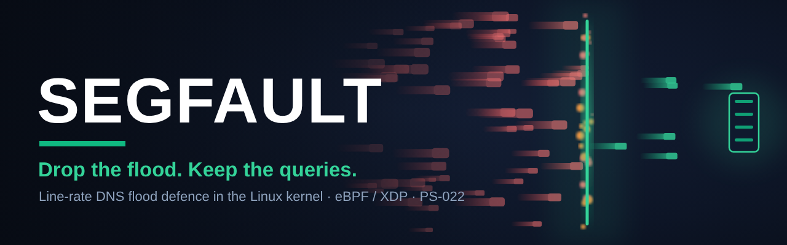

<p align="center">
  
</p>

<p align="center">
  <b><i>Drop the flood. Keep the queries.</i></b><br>
  Line-rate DNS flood defence in the Linux kernel — built on eBPF / XDP
</p>

<p align="center">
  
  
  
  
  
</p>

<div align="center">

| | |
|---|---|
| **Team** | Segfault |
| **Team code** | A3-PS022-TC005 |
| **Institute** | Institute of Engineering & Management (IEM), Kolkata |
| **Problem statement** | PS-022 — eBPF/XDP Rate Limiting for DNS Query Floods in a Lab |
| **Category** | Cybersecurity |

</div>

---

## The problem

A DNS resolver does real work for every query — parsing, cache lookup, and on a miss a full upstream recursion. Attackers exploit that asymmetry: UDP source addresses are trivially forged, so a flood can bury legitimate users before the link is even full. Classic defences (RRL, nftables hashlimit, fixed-threshold XDP) cap one number — the **rate** — which is exactly the number an attacker tunes around:

- **Adaptive floods** spread across thousands of forged sources, each just under the cap.
- **Prefix-spoof** forges addresses inside the victim's own `/24`, so a per-prefix limit punishes the real client.
- **Water-torture** sends random sub-domains — cheap to send, expensive to resolve.

Against all three, every baseline we tested dropped the real client to **zero**.

## Our approach

Segfault replaces *"how fast is this source?"* with two questions — **who is this, and what does the query cost?** — and enforces the answer in the NIC driver, before the kernel allocates a socket buffer.

1. **Trust by proof** — a source earns standing by proving a real return path (TCP or an RFC 9018 cookie), which an off-path spoofer cannot fake.
2. **Cost, not count** — each query is priced by the work it forces on the server.
3. **Adaptive & reversible** — a controller tightens only as far as the attack forces it.

---

## Demo & documents

| | |
|---|---|
| **Demo video** | [Watch on YouTube](https://youtu.be/2WzXLvkn-UY) |
| **Presentation deck (PDF)** | [`submission/Segfault_Deck.pdf`](submission/Segfault_Deck.pdf) |
| **Project report (PDF)** | [`submission/Segfault_Submission.pdf`](submission/Segfault_Submission.pdf) |

---

## The mathematics

<details open>
<summary><b>GCRA token buckets</b></summary>

Every pool, source and prefix is limited by a Generic Cell Rate Algorithm bucket — a leaky bucket with no timers, stored as one nanosecond timestamp and updated with a lock-free CAS. With rate $\lambda$ and burst $B$:

$$T = \frac{10^9}{\lambda}\ \text{ns}, \qquad \tau = T \cdot B$$

A query of cost $w$ arriving at $t_a$ is admitted iff

$$t_a \ge \text{TAT} - \tau$$

and on admission

$$\text{TAT} \leftarrow \max(t_a,\ \text{TAT}) + w \cdot T$$

A rejected query does not advance the bucket, so a rejected flood cannot starve later legitimate queries.
</details>

<details>
<summary><b>Capacity allocation</b></summary>

With measured capacity $C$ and proven / unknown shares $\sigma_p,\ \sigma_u$:

$$\lambda_{T2} = C\,\sigma_p, \qquad \lambda_{T0} = (C - \lambda_{T2})\,\sigma_u, \qquad \lambda_{T1} = \max\big((C-\lambda_{T2})(1-\sigma_u),\ 0.05\,C\big)$$

Lab defaults $C = 20{,}000$, $\sigma_p = 0.5$, $\sigma_u = 0.3$ reserve 10,000 q/s for proven clients and cap unknown traffic at 3,000 q/s.
</details>

<details>
<summary><b>Count-Min sketch (stateless T0)</b></summary>

$$\hat{c}(x) = \min_{1 \le j \le d} C\big[j,\ h_j(x) \bmod w\big]$$

$$\hat{c}(x) \le c(x) + \varepsilon N \quad \text{with probability} \ge 1-\delta, \qquad w = \lceil e/\varepsilon \rceil,\ d = \lceil \ln(1/\delta) \rceil$$

$O(d)$ memory touches per packet, independent of how many sources are spoofed.
</details>

<details>
<summary><b>Cost weighting</b></summary>

$$w = w_0 \cdot m_{\text{ANY}}^{[\text{ANY}]} \cdot m_{\text{DO}}^{[\text{DO}]} \cdot m_{\text{big}}^{[\text{large}]} \cdot z(\text{zone})$$

Defaults $m_{\text{ANY}} = 8,\ m_{\text{DO}} = 2,\ m_{\text{big}} = 3$; $z(\text{zone})$ rises for zones whose NXDOMAIN ratio exceeds 0.2 or 0.5.
</details>

<details>
<summary><b>Proof of address — RFC 9018 cookie</b></summary>

$$SC = \text{SipHash-2-4}_k(\text{client-cookie} \,\|\, \text{version} \,\|\, \text{reserved} \,\|\, \text{timestamp} \,\|\, \text{client-IP})$$

The client IP is an authenticated input, so a cookie minted for one address is invalid from any other.
</details>

<details>
<summary><b>Bounded reflection (TC-slip)</b></summary>

$$\text{reflected rate} \le \frac{1}{k}\,\lambda_{\text{flood}}, \qquad A = \frac{\text{bytes}_{\text{out}}}{\text{bytes}_{\text{in}}} \le 1$$

Reflection is bounded, not eliminated. Lab setting $k = 2$.
</details>

<details>
<summary><b>Adaptive controller</b></summary>

With load $L = a/C$, drop-fraction $\varphi = b/(a+b)$ and response ratio $\rho$:

$$\text{busy} = (L \ge 0.7) \lor (\varphi > 0.2) \lor (\rho < 0.98)$$

$$\text{under\_attack} = (\varphi > 0.6) \lor (\rho < 0.85)$$

CALM → GUARD on *busy*, GUARD → SIEGE on *under\_attack*. Escalation is immediate; de-escalation needs 10 s of stability.
</details>

<details>
<summary><b>Throughput ceiling</b></summary>

$$C_{\max} = \min\!\left(R_{\text{line}},\ N_{\text{core}} \cdot \frac{f}{c}\right), \qquad c \approx 290\ \text{cycles/packet}$$
</details>

---

## How it solves the problem

```text
                 ┌──────────────────────────── XDP ingress (NIC driver) ────────────────────────────┐
 DNS packet ───▶ │ bounded parse ─▶ tier lookup ─▶ T0 sketch ─▶ GCRA: pool · source · prefix ─▶ verdict │ ─▶ PASS / DROP / TX(TC=1)
                 └──────────────────────────────────────────────────────────────────────────────────┘
                                                    ▲ mode · zone costs · epoch
 resolver replies ─▶ tc-egress observer ─▶ userspace controller (CALM / GUARD / SIEGE)
                     (TCP proofs, NXDOMAIN)
```

| Tier | Meaning | How it is entered | Treatment |
|------|---------|-------------------|-----------|
| **T0** | Unknown | default | no per-source state; Count-Min sketch; small capped pool |
| **T1** | Returning | behaves politely | per-source GCRA allowance; strikes → ban |
| **T2** | Proven | TCP proof or valid RFC 9018 cookie | reserved pool floods cannot enter |

An attacker who cannot complete a round-trip can never reach T2, however many sources it forges or however it paces them.

---

## Pseudocode

```text
fn admit(pkt, cfg, state) -> verdict:
    p = parse_bounded(pkt)                    # Eth/VLAN/IP/UDP/DNS on a per-CPU buffer
    if p is None or p.dport != 53: return PASS
    tier = lookup_tier(p.src)                 # T2 proven / T1 returning / T0 unknown
    if tier == T2 or cookie_valid(p, cfg.secret):
        if gcra(state.pool[T2], 1): return PASS
    w = cost(p, cfg)                          # qtype, DO bit, zone NXDOMAIN multiplier
    if tier == T0 and sketch_estimate(p.src) > cfg.heavy:
        return slip_or_drop(p, cfg)
    ok  = gcra(state.pool[tier], w)           # tier pool
    ok &= gcra(state.src[p.src], w)           # per-source
    ok &= gcra(state.pfx[p.prefix], w)        # per-/24 or /48
    if ok: return PASS
    return slip_or_drop(p, cfg)               # 1-in-k → XDP_TX TC=1, else XDP_DROP
```

Full version: [`docs/pseudocode.md`](docs/pseudocode.md)

---

## Results

*Legitimate queries completed / p99 latency. Median of 3 runs. Higher queries and lower p99 are better.*

### IPv4 — six scenarios

| Scenario | none | nftables | nft-netdev | fixed-xdp | **Segfault** |
|----------|------|----------|------------|-----------|--------------|
| single | 557 / 208 ms | 574 / 202 ms | 574 / 203 ms | 1085 / 202 ms | **3712 / 0.75 ms** |
| pulse | 758 / 210 ms | 574 / 202 ms | 574 / 202 ms | 1080 / 202 ms | **3707 / 0.71 ms** |
| distributed | 116 / 414 ms | 53 / 529 ms | 28 / 594 ms | 119 / 544 ms | **3719 / 1.13 ms** |
| adaptive | 180 / 422 ms | 38 / 620 ms | 60 / 451 ms | 65 / 432 ms | **3670 / 1.10 ms** |
| prefix-spoof | 0 | 0 | 0 | 0 | **3729 / 0.42 ms** |
| water-torture | 113 / 392 ms | 49 / 469 ms | 52 / 592 ms | 68 / 680 ms | **3684 / 1.11 ms** |

### IPv6

| Scenario | none | nftables | nft-netdev | fixed-xdp | **Segfault** |
|----------|------|----------|------------|-----------|--------------|
| distributed | 1242 / 204 ms | 97 / 208 ms | 97 / 208 ms | 94 / 205 ms | **3499 / 12.7 ms** |
| water-torture | 2722 / 2.6 ms | 96 / 208 ms | 97 / 208 ms | 96 / 208 ms | **3680 / 1.4 ms** |
| prefix-spoof | 0 | 0 | 0 | 0 | **up to 246 / 0.92 goodput** |

> IPv6 prefix-spoof is intermittent: the slip-to-TCP nudge is currently IPv4-only. IPv6 slip support is the top future-work item.

**Performance:** Segfault sheds **2.32 Mpps at 21 %** of one core, versus 2.52 Mpps at 16 % for a do-nothing `XDP_DROP` — about 40 % more CPU per packet. Raw data: [`results/`](results/).

---

## What Segfault is, and how to use it

Segfault is **two eBPF programs plus a userspace daemon**. The `segfault` CLI loads and pins the XDP and tc programs, then runs as a long-lived controller that polls the counters and re-tunes the datapath. State lives in pinned BPF maps under `/sys/fs/bpf/segfault`, so the datapath keeps running even if the controller restarts.

| Command | What it does |
|---------|--------------|
| `segfault up -i <iface>` | attach the datapath and run the controller |
| `segfault down -i <iface>` | detach everything and remove pinned state |
| `segfault stats` | print the live counters once |
| `segfault top` | live full-screen counter view |
| `segfault why <ip>` | explain the current verdict for one source |
| `segfault mode <calm\|guard\|siege>` | set the defence mode by hand |
| `segfault cookie-secret <hex>` | set the RFC 9018 secret shared with the resolver |
| `segfault serve` | Prometheus `/metrics` and a dashboard on `:9108` |
| `segfault-gen` | flood generator and legitimate-client prober |
| `segfault-bench` | turns raw runs into `results.csv`, charts and a report |

---

## Benchmarks

Five baselines — no filter, nftables prerouting, nftables netdev-ingress, a fixed-threshold XDP limiter (the rival design), and Segfault — across six scenarios.

```bash
IFACE=eth1 GEN_HOST=kali@kali.mshome.net bash lab/bench/run.sh
./target/release/segfault-bench results/raw -o results   # results.csv, goodput.svg, report.md
```

Method and integrity checks: [`docs/benchmarks.md`](docs/benchmarks.md)

---

## Build and run

```bash
make setup ROLE=target        # clang, libbpf, bpftool, Rust, Unbound
make build                    # BPF object + Rust release binaries
make test test-c              # Rust + C parser unit tests
make verify                   # load the datapath through the kernel verifier
sudo make net ROLE=target IFACE=eth1

sudo ./target/release/segfault up -i eth1 --config configs/segfault.toml
./target/release/segfault stats
./target/release/segfault why 10.53.0.20
sudo ./target/release/segfault down -i eth1
```

Single-host smoke test, no second VM needed: `sudo make e2e`

## Two proof paths to "proven" (T2)

1. **TCP** — a client that answers a TC-slip over TCP is seen by the egress observer and promoted.
2. **RFC 9018 DNS cookie** — verified in XDP with SipHash-2-4 against a secret shared with the resolver.

A spoofer can do neither. Set the same secret on Segfault (`segfault cookie-secret`) and Unbound (`cookie-secret:` in `lab/dns/unbound.conf`).

## Three ideas

1. **Trust before rate.** Unknown sources get no per-source state, only a fixed-memory sketch, so a spoofed flood can never exhaust memory.
2. **Cost, not count.** ANY queries, the DNSSEC DO bit, large types and high-NXDOMAIN zones all cost more tokens.
3. **Measured capacity.** Limits are shares of the server's real measured capacity, moved between CALM / GUARD / SIEGE by live feedback.

---

## Layout

```text
Segfault/
├── bpf/                    XDP + tc datapath
│   ├── segfault.bpf.c      admission program and egress observer
│   ├── parse.h             bounded Eth / VLAN / IP / UDP / DNS parser
│   ├── limit.h             GCRA token buckets
│   ├── slip.h              truncated TC=1 reply builder
│   ├── cookie.h            RFC 9018 cookie validation
│   └── maps.h · shared.h   pinned maps and shared types
├── crates/
│   ├── core/               config, maps, stats
│   ├── cli/                the `segfault` controller
│   ├── gen/                flood generator and prober
│   └── bench/              report and chart builder
├── lab/
│   ├── bench/run.sh        full baseline × scenario matrix
│   ├── dns/                Unbound configs
│   ├── nft/                nftables baselines
│   ├── netns/              single-host e2e
│   └── vm/                 two-VM lab setup
├── tests/                  parser unit + fuzz tests
├── configs/                segfault.toml
├── docs/                   pseudocode · architecture · benchmarks
├── results/                raw/ (IPv4) · raw6*/ (IPv6) · raw-rec*/ (recursive) · charts
└── submission/             project report PDF · deck PDF · video frames
```

---

<div align="center">

## Team Segfault

**Debangan Mali**  ·  **Saraswata Chatterjee**  ·  **Partha Chakraborty** *(Faculty mentor)*

Institute of Engineering & Management, Kolkata  ·  Team A3-PS022-TC005

debanganmali99@gmail.com

</div>

## License

Released under the terms in [`LICENSE`](LICENSE). Third-party licence texts are in [`LICENSES/`](LICENSES/).
