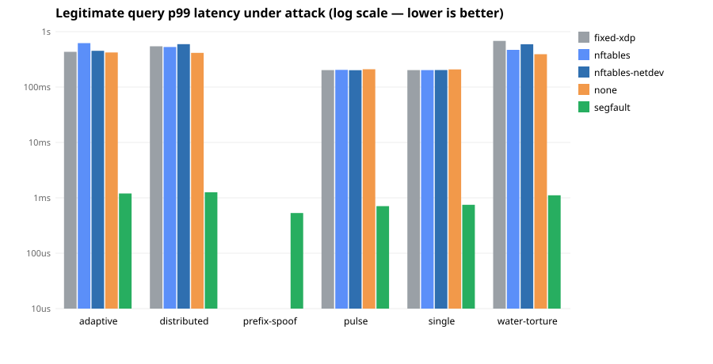
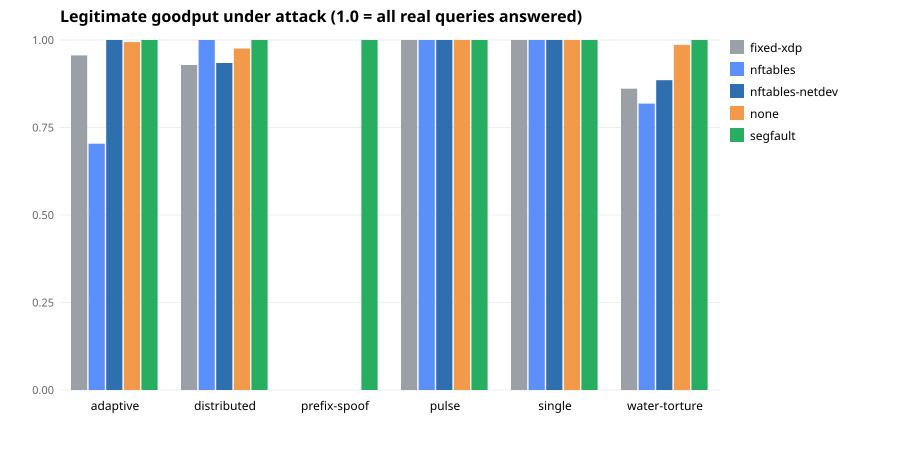

# Segfault benchmark results

A legitimate client sends DNS queries throughout each attack. Because a real resolver falls back to TCP, almost every query *eventually* succeeds under every baseline — so the story is **latency and throughput**, not success rate.

- **p99 latency**: how slow the real client's queries get under attack (lower is better).
- **Throughput**: legitimate queries the client completed during the run (higher is better).

| Scenario | Baseline | p50 (us) | p99 (us) | Legit done | Goodput |
|---|---|---:|---:|---:|---:|
| adaptive | fixed-xdp | 326752 | 432430 | 65 | 0.956 |
| adaptive | nftables | 287834 | 619672 | 42 | 0.704 |
| adaptive | nftables-netdev | 327968 | 451360 | 65 | 1.000 |
| adaptive | none | 22883 | 421529 | 330 | 0.994 |
| adaptive | segfault | 176 | 1200 | 3670 | 1.000 |
| distributed | fixed-xdp | 164387 | 544308 | 119 | 0.929 |
| distributed | nftables | 307332 | 528947 | 78 | 1.000 |
| distributed | nftables-netdev | 316944 | 593934 | 71 | 0.934 |
| distributed | none | 55231 | 414310 | 161 | 0.976 |
| distributed | segfault | 198 | 1257 | 3719 | 1.000 |
| prefix-spoof | fixed-xdp | 0 | 0 | 0 | 0.000 |
| prefix-spoof | nftables | 0 | 0 | 0 | 0.000 |
| prefix-spoof | nftables-netdev | 0 | 0 | 0 | 0.000 |
| prefix-spoof | none | 0 | 0 | 0 | 0.000 |
| prefix-spoof | segfault | 169 | 532 | 3729 | 1.000 |
| pulse | fixed-xdp | 187 | 202301 | 1080 | 1.000 |
| pulse | nftables | 202 | 204012 | 574 | 1.000 |
| pulse | nftables-netdev | 187 | 201820 | 574 | 1.000 |
| pulse | none | 2894 | 209815 | 772 | 1.000 |
| pulse | segfault | 226 | 707 | 3707 | 1.000 |
| single | fixed-xdp | 168 | 202286 | 1085 | 1.000 |
| single | nftables | 200 | 201967 | 574 | 1.000 |
| single | nftables-netdev | 185 | 202615 | 574 | 1.000 |
| single | none | 3335 | 208172 | 557 | 1.000 |
| single | segfault | 246 | 749 | 3712 | 1.000 |
| water-torture | fixed-xdp | 141682 | 680519 | 68 | 0.861 |
| water-torture | nftables | 307008 | 469004 | 49 | 0.818 |
| water-torture | nftables-netdev | 325933 | 592176 | 52 | 0.885 |
| water-torture | none | 252640 | 392226 | 113 | 0.986 |
| water-torture | segfault | 201 | 1112 | 3684 | 1.000 |

